## Team details

| Role | Name | Enrollment No. | GitHub Username |
|------|------|----------------|-----------------|
| Group Lead | Rishi Raj Agarwal | 2501010377 | RxThetaxx |
| Member 2 | Pratham Madaan | 2501010348 | madaanpratham80-cpu |
| Member 3 | Piyush Purkait | 2501010334 | Piyushdev-X |
| Member 4 | Khyati Dash | 2501010223 | khyati211012008 |

**Team No.:** T0134 · **Section:** C/D/E · **Repository URL:** https://github.com/madaanpratham80-cpu/Kaizen_AP_2026.git

# KAIZEN

  

**KAIZEN** is a personal consistency and achievement app that turns real-world commitments into a clear daily routine, reflecting your follow-through through character health, XP, streaks, and a permanent record of progress.

The core product principle is **continuity with recovery**: missing a day gives you a clear path back into your routine rather than erasing your long-term progress.

---

## Core Philosophy

Most habit trackers punish a single missed day by wiping out your progress, making it easy to quit entirely. KAIZEN separates **lifetime progress** from **daily streaks**:

- **Permanent XP:** Inactivity never removes earned XP or levels.
- **Planned Rest:** Scheduled rest days are built into the calendar and protect your streak.
- **Guided Recovery:** After a missed day, the app shifts focus to recovery steps and rewards you for bouncing back.

---

## User Flow

1. **Create Commitments (Quests):** Define personal or recurring tasks under three growth pillars (**Cognitive**, **Physical**, and **Craft**), assign a difficulty (**Easy**, **Medium**, or **Hard**), and set your schedule.
2. **Start Your Day (Today):** Open the daily hub to view your snapshotted schedule for the day, your locked priority quest, and your character's current health and streak.
3. **Complete & Activate:** Check off quests from **Today** or **Habits**. Completing your locked priority quest marks the day as **ACTIVE** and extends your streak.
4. **Add Spontaneous Wins (Quick Quests):** Log unplanned, ad-hoc tasks for bonus XP and lifetime milestone progress without affecting your scheduled compliance or health penalties.
5. **Review & Recover (Progress & Profile):** At the end of the day, completed planned tasks restore health while unfinished planned work carries a small health penalty. If you miss a scheduled day, KAIZEN provides recovery guidance to help you lock in your next active day.

---

## The Five Core Screens

- **Today:** The daily command center displaying character state, health, current streak, the day's priority quest, remaining scheduled tasks, and recovery guidance.
- **Quests:** The workspace for creating and managing personal or recurring commitments with categories, growth pillars, difficulty tiers, and XP values.
- **Habits:** A 7-day rolling view of scheduled quest occurrences, per-habit streaks, and completion rates.
- **Progress:** A long-term dashboard featuring a 365-day activity heatmap, a chronological progress ledger, unlocked achievements, and growth breakdowns across **Cognitive**, **Physical**, and **Craft** pillars.
- **Profile:** A summary of your character, current level, rank, personal goals, and full achievement archive.

---

## Progression & Calendar Rules

### XP & Leveling
- **Easy Quest:** +10 XP
- **Medium Quest:** +20 XP
- **Hard Quest:** +35 XP
- **Level Up:** Every **100 XP** advances your character by one level. Lifetime XP never decreases.

### Character Health
- Health starts at **70** and stays bounded between **0 and 100**.
- Completing planned tasks restores up to **+5 Health** per day based on the share of planned work finished.
- Incomplete planned tasks apply a close-of-day health penalty.
- Days with zero planned tasks (and ad-hoc Quick Quests) are excluded from health penalties.

### Day States & Streaks
- **ACTIVE:** Achieved when the day's locked priority quest is completed; increases your streak.
- **REST & EMPTY:** Planned rest days and unscheduled days preserve your current streak without increasing it.
- **Missed Day:** Resets the active streak and triggers recovery guidance for the following day.
- Schedule edits apply only to future unopened days; once a day opens, its scheduled tasks and deadline are snapshotted in your local timezone.

### Starter Seals (Achievements)
Each starter seal awards **+25 bonus XP**:
- **Seven-Day Warrior:** Complete 7 ACTIVE scheduled days in a row.
- **Iron Will:** Complete your first ACTIVE day after a missed scheduled day.
- **Hundred Gates:** Complete 100 total quest occurrences.

---

## Data Model Overview

KAIZEN organizes user progression across eight core entities:
- **User:** Account profile, authentication credentials, and local timezone.
- **PlayerState:** Real-time character stats (`total_xp`, `health`, `current_streak`, `best_streak`).
- **Quest:** Commitment templates defining category, pillar, recurrence, difficulty, and XP reward.
- **DayPlan:** Daily agenda snapshots tracking the date, day status, and planned task count.
- **QuestOccurrence:** Individual scheduled task instances tied to a specific `Quest` and `DayPlan`.
- **ProgressEvent:** Append-only ledger recording every XP and health change.
- **Achievement & UserAchievement:** Catalog of milestone badges and records of unlocked seals per user.

---

## Project Structure & Stack

- **`apps/web`:** Next.js (App Router) frontend interface
- **`apps/api`:** Node.js & Express backend API
- **`packages/contracts`:** Shared Zod request/response schemas
- **Database:** PostgreSQL with Prisma ORM

### Common Commands
- Install dependencies: `pnpm install`
- Run linter: `pnpm lint`
- Run unit tests: `pnpm test`
- Run database tests: `pnpm test:db`
- Build workspace: `pnpm build`